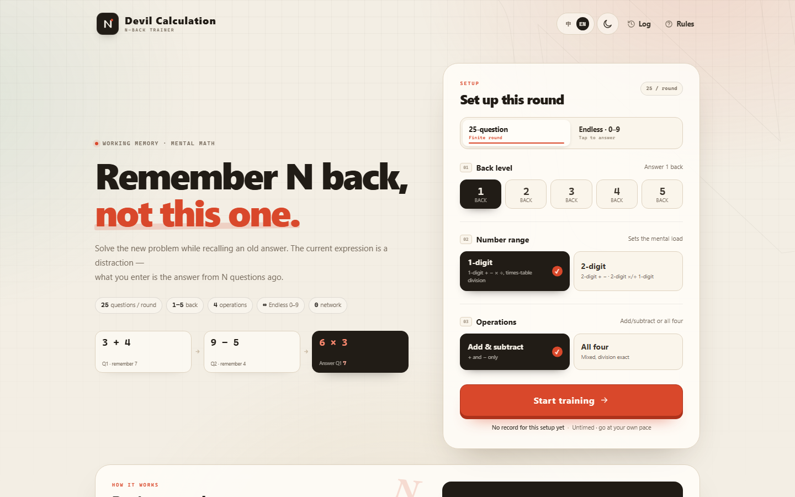
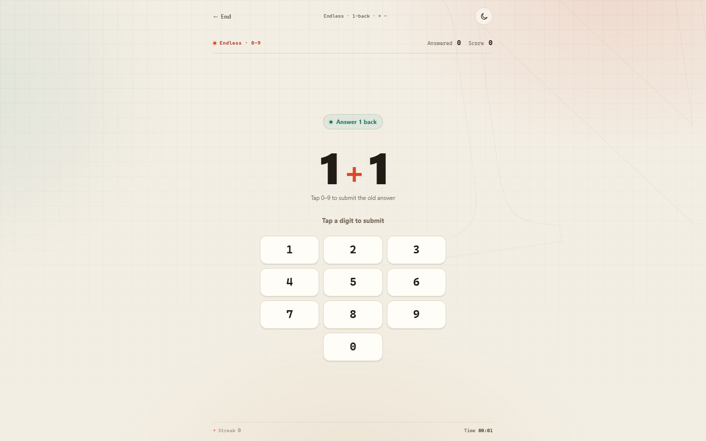

[中文](README.md) | **English**

# Devil Calculation · N-Back Mental Math

A completely offline, single-file working-memory math game: solve the current problem while recalling the answer from **N questions back**.

Open [`魔鬼计算.html`](魔鬼计算.html) in Chrome or Edge. No install, server, or network connection is required.



## Two modes

### 25-question training
- Choose a back level from 1–5
- 25 scored questions per round, plus N warm-up questions
- 1-digit or 2-digit questions
- Add/subtract, or all four operations
- Multi-digit input with delete and confirm keys
- A wrong answer shows the old correction and then continues

### Endless · 0–9
- Every answer is fixed to **0–9**
- A 3-column keypad with only 0–9; delete and confirm are hidden, and 0 is centered
- **Tap a digit to submit immediately** — no confirm or delete; a wrong answer briefly shows the correct answer, then advances
- Keep going until you stop; ending the run saves an endless result
- Inherits the current back level and operation type
- Live answered/score counters at the top
- Endless records are stored and compared separately



## Chinese / English

Use the `中 / EN` switch in the header. The choice is remembered. The home, setup, rules, in-game prompts, correction panel, result, history, and help screens all follow the selected language. A round keeps the language it started with; switch again from the home or result screen.

## Rules

The current expression is a distraction. Work it out, remember the answer, and later enter the answer from N questions back:

```
Q1  3 + 4   → remember 7
Q2  9 − 5   → remember 4
Q3  6 × 3   → answer Q1: 7
```

- Subtraction never goes negative
- Division is always exact
- In 2-digit mode: +/− use two-digit operands; ×/÷ pair a two-digit number with a one-digit number
- Untimed — go at your own pace
- 100 points per correct answer; a normal round maxes out at 2,500

## Light / dark

Use the header button to switch themes. The choice is remembered. The dark theme uses:

- Page background `rgb(17, 24, 39)`
- Keys/options `rgb(55, 65, 81)`
- Panel layer `#1F2937`

## Data

All code, styles, and data live in `魔鬼计算.html`. Training records are stored only in the browser's `localStorage` and are never uploaded; clearing site data clears them.

## Development

Sources and build scripts are in [`dev/`](dev/):

```bash
# Rebuild the single-file release
node dev/build.mjs

# Engine tests
node dev/test-engine.mjs
```

Project layout:

```
魔鬼计算.html      # single-file release
dev/               # markup, styles, engine, UI, build, and tests
preview/           # desktop / mobile / dark-theme screenshots
```

## Browser

A recent Chrome or Edge is recommended. The layout has been checked at 1440 / 390 / 320px.

## License

See [LICENSE](LICENSE).

---

[中文](README.md) | **English**
