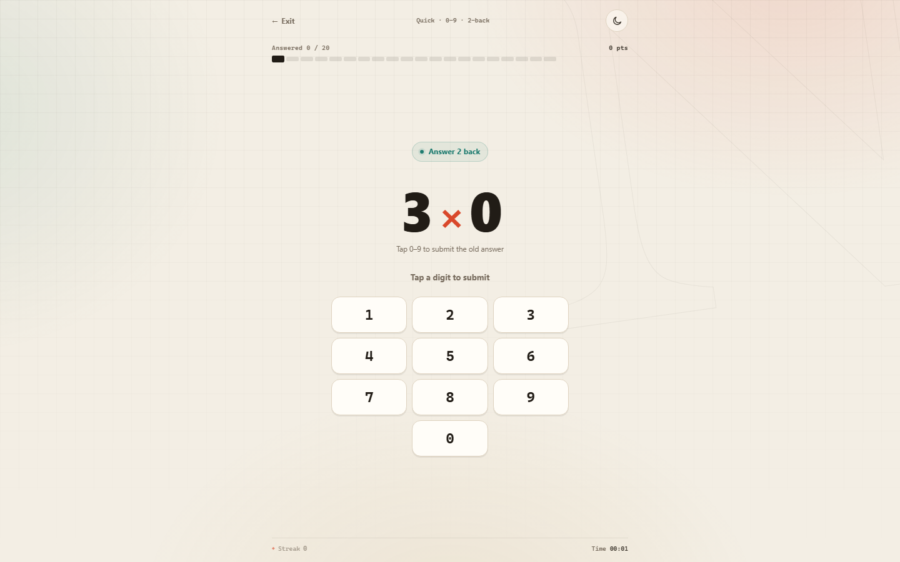

**中文** | [English](README.en.md)

# 魔鬼计算 · N-Back 心算

一个完全离线的单文件心算记忆小游戏：一边计算当前题，一边回答 **N 题前**的答案。

双击 [`魔鬼计算.html`](魔鬼计算.html) 用 Chrome / Edge 打开即可。不需要安装、不需要本地服务器、不需要联网。


## 两种模式

### 25 题训练
- 回溯层数 1–5 自选
- 每局 25 道计分题，另有 N 道记忆热身
- 个位数 / 两位数
- 加减 / 加减乘除
- 多位数输入，保留删除和确认键
- 答错会显示旧题正确答案，可继续下一题

### 快速 · 0–9
- 每轮 **20 题**，所有题目的结果固定为 **0–9**
- 默认使用 **加减乘除**；快速模式不提供运算类型选择
- 沿用 3 列数字键盘，仅保留 0–9，删除/确认隐藏，0 居中
- 顶部显示 20 题进度；**点数字立即提交**，答错短暂显示答案后自动下一题
- 答完 20 题结算；整轮正确率**严格超过 90%**（19/20 或 20/20）可进入更高回溯
- 未超过 90% 保持当前回溯，可再来一轮
- 通过后设置中的回溯等级自动 +1（最高 5）；中途退出不保存本轮
- 快速最佳只统计通过轮次，历史记录仍保留所有完成轮次



## 中文 / English

右上角 `中 / EN` 切换语言，选择会记住。首页、设置、规则、游戏提示、错题纠正、结算、历史和帮助都会跟随切换；游戏进行中保持开局语言，回到首页或结算页可以再切换。


## 规则

当前算式只是干扰项。你要计算它、记住答案，并在之后回答 N 题前那道题的答案：

```
第 1 题  3 + 4   → 记住 7
第 2 题  9 − 5   → 记住 4
第 3 题  6 × 3   → 回答第 1 题：7
```

- 减法不会出现负数
- 除法保证整除
- 两位数模式下：加减为两位 ± 两位；乘除为两位 ×/÷ 一位
- 不限时，按自己的节奏
- 总分 100 分/题；普通模式满分 2500，快速模式每轮 20 题满分 2000

## 亮色 / 暗色

右上角按钮切换主题，选择会记住。暗色主题：

- 页面背景 `rgb(17, 24, 39)`
- 按键/选项 `rgb(55, 65, 81)`
- 面板层 `#1F2937`

## 数据

所有代码、样式和数据都在 `魔鬼计算.html` 里。训练记录只保存在浏览器 `localStorage`，不会上传任何内容；清除站点数据会清空记录。

## 开发

源码与构建脚本在 [`dev/`](dev/)：

```bash
# 重新生成单文件成品
node dev/build.mjs

# 引擎测试
node dev/test-engine.mjs
```

文件结构：

```
魔鬼计算.html      # 单文件成品
dev/               # 页面结构、样式、引擎、交互、构建和测试
preview/           # 桌面 / 手机 / 暗色主题预览图
```

## 浏览器

建议使用较新的 Chrome / Edge；支持桌面、平板和手机宽度，已在 1440 / 390 / 320px 下验证。

## 许可

见 [LICENSE](LICENSE)。

---

**中文** | [English](README.en.md)

